# Fundición de Metal en Arena

> **Advertencias de Seguridad:**  
> * **Riesgo Respiratorio:** La arena de fundición utilizada (*arena roja aglomerada*) contiene sílice fina y aglutinantes que resultan **tóxicos y cancerígenos si se inhalan**. Es obligatorio utilizar mascarilla o respirador adecuado durante su manipulación.  
> * **Riesgo Térmico:** El horno opera a altas temperaturas ($320\text{ }^\circ\text{C}$) y el metal fundido puede provocar quemaduras graves. Se debe portar equipo de protección personal completo (traje aluminizado/ignífugo, careta facial y guantes de carnaza) y trabajar estrictamente sobre superficies metálicas.

---

## 1. Preparación del Molde de Arena (*Petrobond*)

### 1.1 Material de Moldeo y Modelo Maestro

Para generar la cavidad del molde se utilizó **arena roja para fundición** (tipo *Petrobond*), la cual está aglomerada con aceites y ceras especiales que le permiten compactarse y retener con alta precisión los detalles del modelo sin necesidad de añadir agua. Como modelo patrón se empleó la figura de yeso del patito.

### 1.2 Compactación y Agente Desmoldante

El proceso de moldeo en caja (*flask* de dos partes) puede realizarse a una cara (molde abierto) o a dos caras (molde cerrado completo):

1. **Primera Mitad (Base):** Se colocó la primera mitad de la caja de moldeo, se rellenó con arena roja compactándola firmemente alrededor del modelo de yeso hasta la línea de partición.
2. **Aplicación de Talco Separador:** Antes de colocar y compactar la segunda mitad de la caja, se espolvoreó **talco industrial** sobre toda la superficie de la arena y el modelo. Esto evita que ambas capas de arena se adhieran entre sí y permite abrir el molde limpiamente.

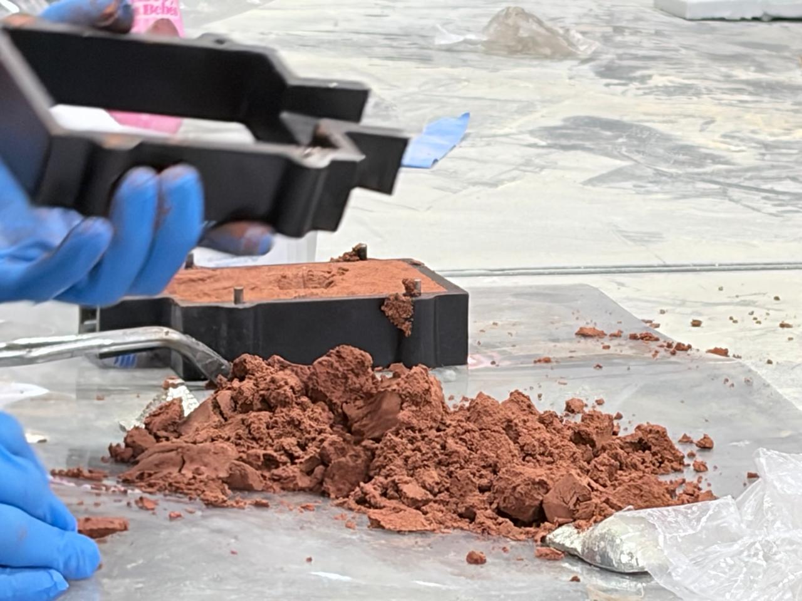{ width=35% }
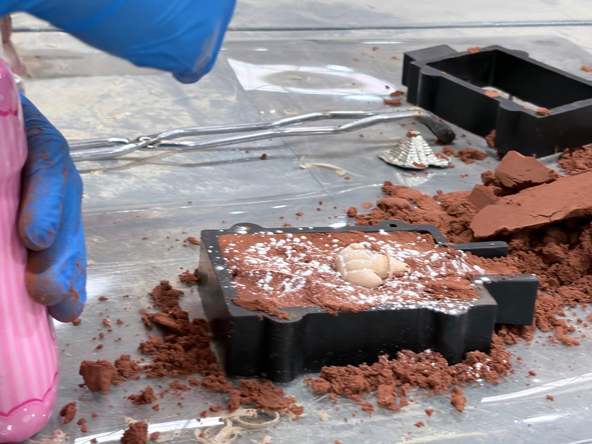{ width=35% }

### 1.3 Formación de la Segunda Mitad y Bebedero

1. Se ensambló la parte superior de la caja de moldeo, se rellenó con más arena compactada y se abrió cuidadosamente para retirar el modelo de yeso, dejando la huella exacta en ambas mitades.
2. **Canal de Alimentación (Bebedero):** Se perforó un conducto vertical (bebedero) hacia la cavidad para permitir el ingreso del metal líquido. Finalmente, ambas mitades se cerraron y alinearon listas para recibir la colada.

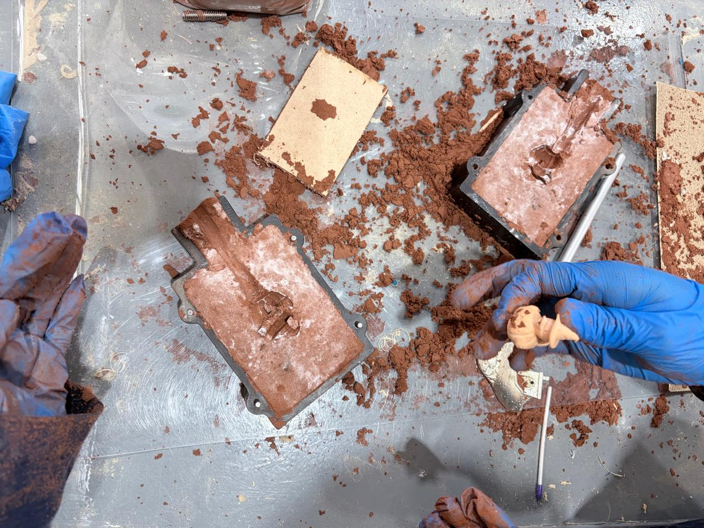{ width=35% }
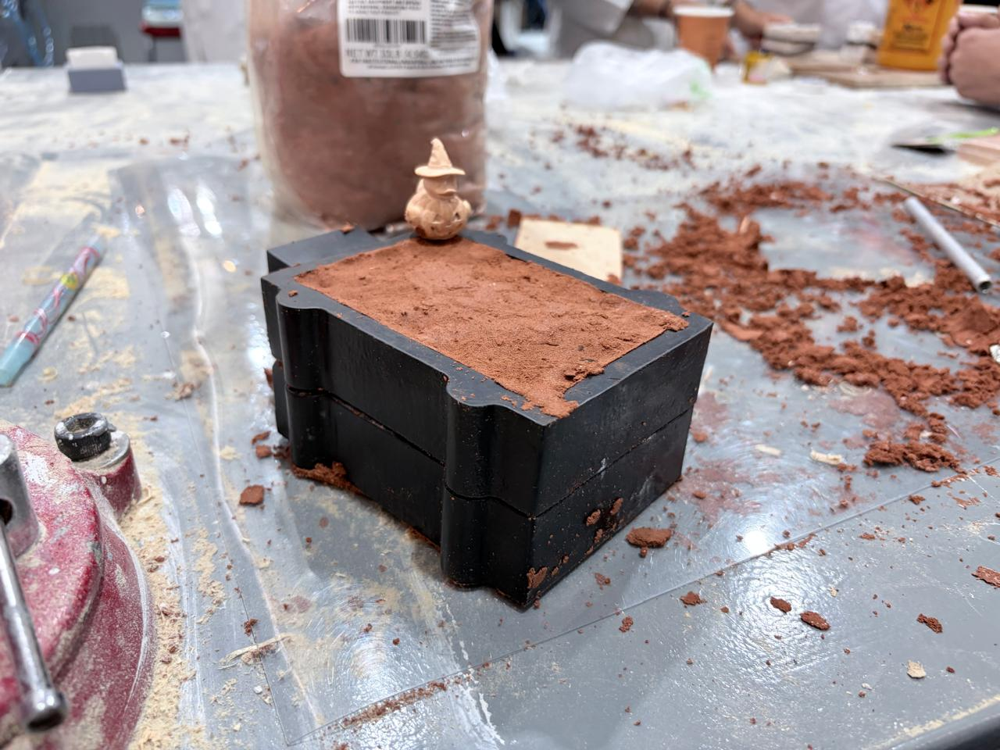{ width=35% }

---

## 2. Fusión del Metal (Estaño)

### 2.1 Calentamiento en Horno

Para la pieza metálica se seleccionó **estaño** debido a su bajo punto de fusión y buena fluidez.

1. Se colocó el metal dentro de un crisol y se introdujo en un **horno eléctrico de mufla** (utilizado comúnmente para fundición y quemado de moldes de inversión/yeso).
2. Se configuró el horno hasta alcanzar la temperatura de colada (*casting temperature*) del estaño, establecida en **$320\text{ }^\circ\text{C}$**, esperando el tiempo necesario hasta verificar que el metal estuviera completamente en estado líquido.

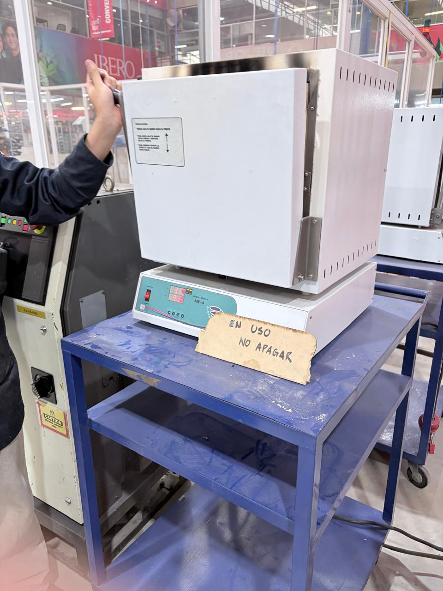{ width=35% }  

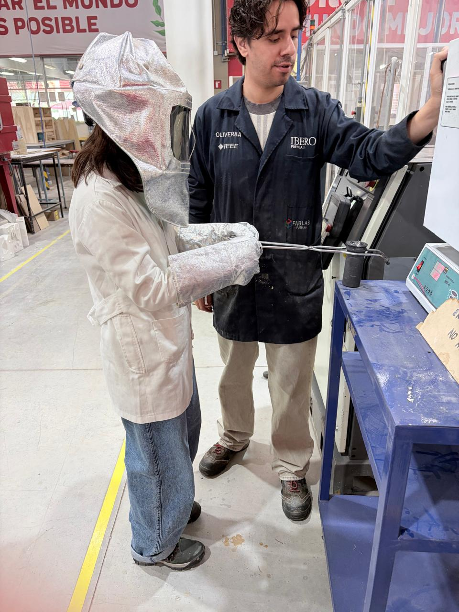{ width=35% }
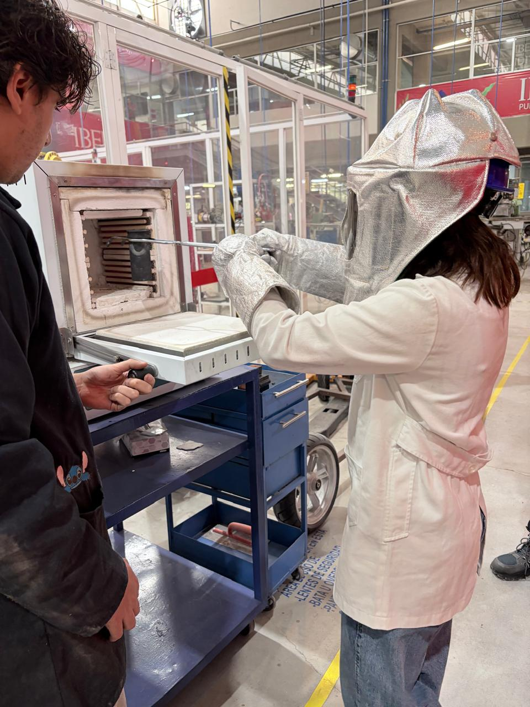{ width=35% }

### 2.2 Extracción del Crisol

Una vez alcanzada la temperatura de $320\text{ }^\circ\text{C}$, y portando el traje especial de protección térmica, se abrió el horno y se retiró el crisol con el estaño fundido utilizando **pinzas largas de fundición** para mantener una distancia segura.

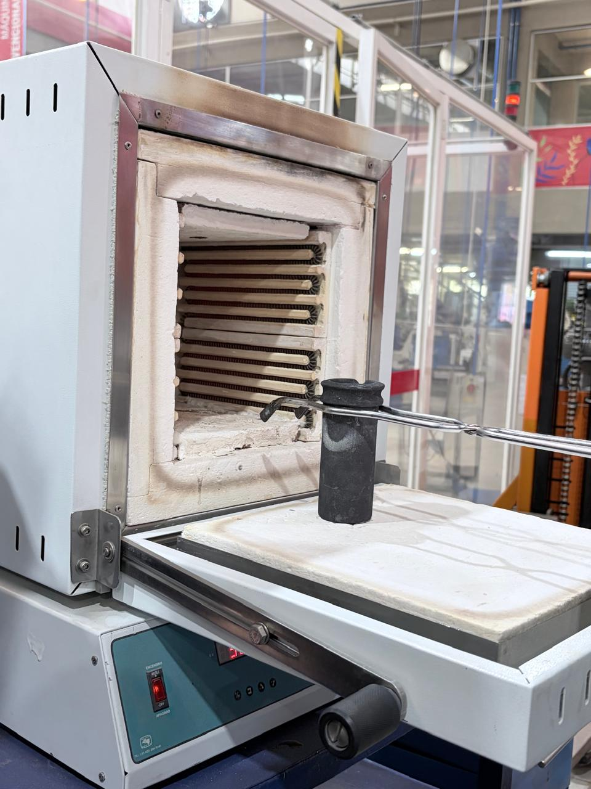{ width=35% }
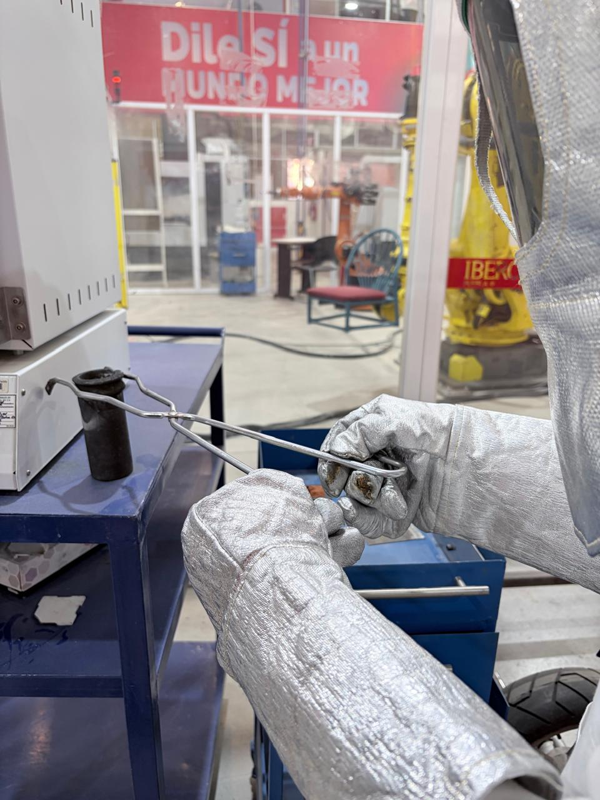{ width=35% }

---

## 3. Vaciado y Acabado de la Pieza

### 3.1 Colada en el Molde

El molde de arena armado se colocó previamente sobre una **mesa de trabajo metálica** (evitando mesas de madera o superficies inflamables ante posibles derrames).

* Con movimiento continuo y controlado, se vertió el estaño líquido a través del bebedero hasta llenar por completo la cavidad del molde.

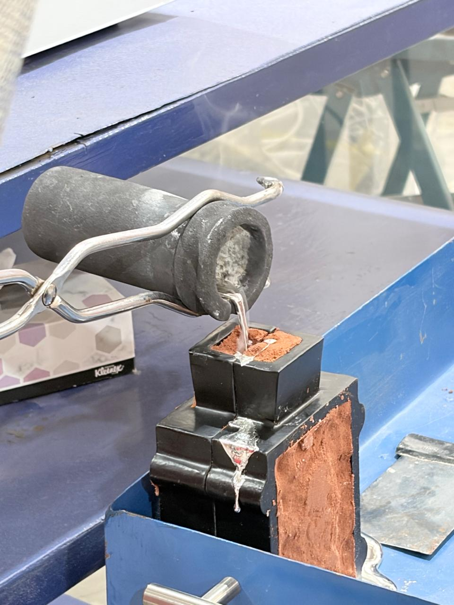{ width=35% }  
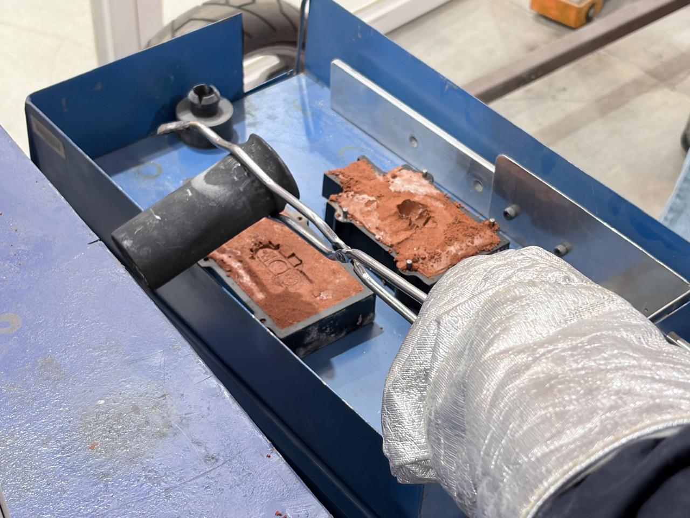{ width=35% }

### 3.2 Enfriamiento, Desmolde y Limpieza

1. **Solidificación:** Se dejó reposar el molde a temperatura ambiente hasta que el estaño solidificó y enfrió lo suficiente para ser manipulado de forma segura.
2. **Desmolde y Acabado:** Se rompió el molde de arena para extraer la pieza metálica. Finalmente, se cortó el excedente de metal correspondiente al canal de entrada (bebedero) y se limaron las rebabas de la línea de partición para obtener el acabado final de la figura.

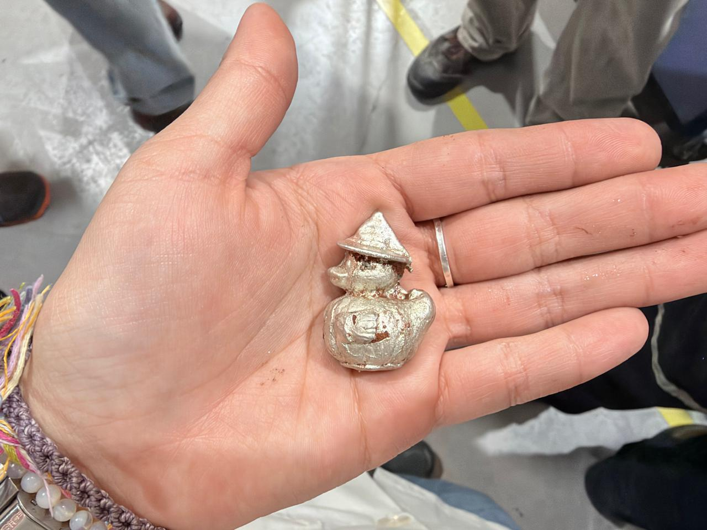{ width=35% }
